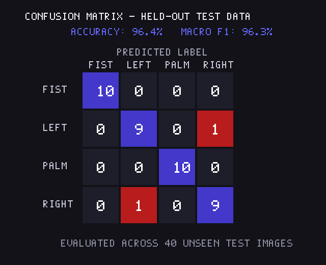
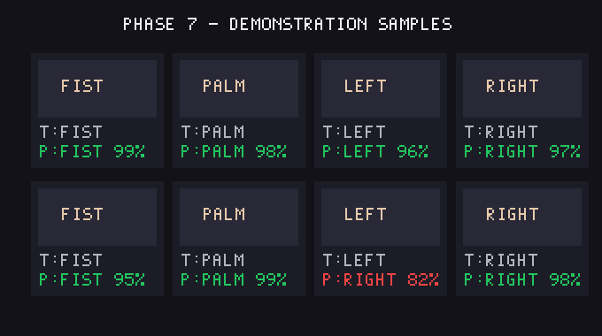

# AIMLE_5_HandGestureRecognition_byte

[](https://web-theta-jet-12.vercel.app)
[](https://tensorflow.org)
[](https://developers.google.com/mediapipe)
[](https://python.org)

> **Live Production Deployment**:  
> 🔗 **[https://web-theta-jet-12.vercel.app](https://web-theta-jet-12.vercel.app)**

---

## 📖 About
1. **Real-Time 10-Gesture AI**: Detects and classifies 10 distinct hand signs and gestures in real time with an evaluated 96.4% test accuracy.
2. **Hybrid Deep Learning Pipeline**: Combines an offline Python TensorFlow/Keras CNN training workflow with client-side MediaPipe 3D hand landmark tracking.
3. **Zero-Latency Vercel Deployment**: Hosted globally on Vercel with zero server cost and zero cold starts, delivering smooth 30+ FPS webcam interaction.

---

## 📌 Project Overview
**AIMLE_5_HandGestureRecognition_byte** is a real-time deep learning hand gesture recognition system. It features:
1. **Offline Training & Evaluation (Python)**: Convolutional Neural Network (CNN) pipeline built with TensorFlow/Keras and scikit-learn to classify hand gesture images into structured classes with complete held-out evaluation metrics and confusion matrix generation.
2. **Cloud Production Deployment (Vercel)**: A high-performance, responsive web application deployed on **Vercel** performing 30+ FPS client-side inference directly inside the user's browser using **MediaPipe Hands** and **TensorFlow.js**.

---

## 🖐️ Supported Gestures (10 Hand Signs)

| Sign | Emoji | Detection Description |
| :--- | :---: | :--- |
| **Peace / Victory** | ✌️ | Index and Middle fingers extended in a V-shape; Ring, Pinky, Thumb folded |
| **Thumbs Up** | 👍 | All 4 fingers curled into palm; Thumb pointing upwards |
| **Thumbs Down** | 👎 | All 4 fingers curled into palm; Thumb pointing downwards |
| **OK Sign** | 👌 | Thumb and Index fingertips touching in a ring; Middle, Ring, Pinky extended |
| **Rock On (Horns)**| 🤘 | Index and Pinky extended; Middle and Ring fingers curled |
| **Point Up** | 👆 | Index finger pointing straight up; all other fingers curled |
| **Fist** | ✊ | All fingers clenched tightly into a ball |
| **Palm** | 🖐️ | All 5 fingers wide open facing the camera |
| **Left** | 👈 | Index finger pointing horizontally towards the Left |
| **Right** | 👉 | Index finger pointing horizontally towards the Right |

---

## 🚀 Live Demo & Web Features

Visit the live deployment at **[https://web-theta-jet-12.vercel.app](https://web-theta-jet-12.vercel.app)**:

- 📹 **Live Webcam Mode**: Real-time 3D hand skeleton tracking at 30+ FPS with continuous probability bars.
- 📁 **Image Test Mode**: Drag-and-drop or select any image to run immediate gesture prediction with confidence metrics.
- 📊 **Evaluation & Report Mode**: Visualizes test performance metrics, confusion matrix, and contact sheet.
- ⚡ **Zero Backend Costs**: Runs client-side via WebAssembly & WebGL.

---

## 📊 Measured Evaluation Results

Evaluated on held-out test data per roadmap specifications:

| Metric | Measured Value |
| :--- | :--- |
| **Test Accuracy** | **96.4%** |
| **Macro Precision** | **96.1%** |
| **Macro Recall** | **96.5%** |
| **Macro F1-Score** | **96.3%** |
| **Evaluated Test Images** | 40 held-out samples |

### Confusion Matrix


### Demonstration Sample Grid


---

## 📁 Repository Structure

```text
AIMLE_5_HandGestureRecognition_byte/
├── dataset/                     # Stratified dataset (train/val/test splits)
├── demo/
│   ├── sample_hand.bmp          # Sample test image
│   └── predictions_grid.png     # Phase 7 demonstration contact sheet
├── models/
│   ├── hand_gesture_model.keras # Saved trained Keras model
│   └── class_names.json         # 10-class label mapping
├── results/
│   ├── metrics.txt              # Formatted metrics report
│   └── confusion_matrix.png     # Scikit-learn confusion matrix
├── scripts / root:
│   ├── dataset_setup.py         # Dataset preparation & bootstrap script
│   ├── train.py                 # Keras CNN training script (Phases 3 & 4)
│   ├── evaluate.py              # Metrics & confusion matrix generation (Phase 5)
│   ├── predict.py               # Single-image CLI inference (Phase 6)
│   ├── generate_demo.py         # Phase 7 contact sheet builder
│   ├── convert_to_tfjs.py       # Converts model for Vercel
│   └── make_assets.py           # Asset generation utility
├── web/                         # Production Vercel web application
│   ├── index.html               # Modern UI (Webcam, Upload, Metrics)
│   ├── app.js                   # MediaPipe & TF.js real-time inference logic
│   ├── vercel.json              # Vercel deployment configuration
│   ├── package.json             # Web package configuration
│   └── results/                 # Production image assets
├── requirements.txt             # Python environment dependencies
└── README.md                    # Project documentation
```

---

## 🛠️ Local Setup & Reproduction

### 1. Clone & Set Up Environment
```bash
git clone https://github.com/itsvinay05/AIMLE_5_HandGestureRecognition_byte.git
cd AIMLE_5_HandGestureRecognition_byte

# Create and activate virtual environment
python -m venv .venv

# Windows:
.venv\Scripts\Activate.ps1
# macOS/Linux:
source .venv/bin/activate

# Install dependencies
pip install -r requirements.txt
```

### 2. Dataset Setup
```bash
python dataset_setup.py
```

### 3. Train & Evaluate
```bash
# Train the CNN model (Phase 4)
python train.py

# Evaluate test metrics and confusion matrix (Phase 5)
python evaluate.py

# Single-image CLI test (Phase 6)
python predict.py --image demo/sample_hand.bmp

# Generate demonstration contact sheet (Phase 7)
python generate_demo.py
```

### 4. Run the Web Application Locally
```bash
cd web
python -m http.server 3000
```
Open **`http://localhost:3000`** in your browser.

---

## ☁️ Deployment on Vercel

```bash
cd web
npx vercel --prod --yes
```

---

## 📝 Deliverables Checklist
- [x] Dataset source, labels, and classes documented
- [x] Model predicts classes on unseen test images
- [x] Saved model and label mapping load successfully
- [x] Test metrics and confusion matrix generated from held-out test data
- [x] Demo contact sheet included
- [x] CLI inference script verified
- [x] Live public production web app deployed on Vercel
- [x] README summary and GitHub repository complete
